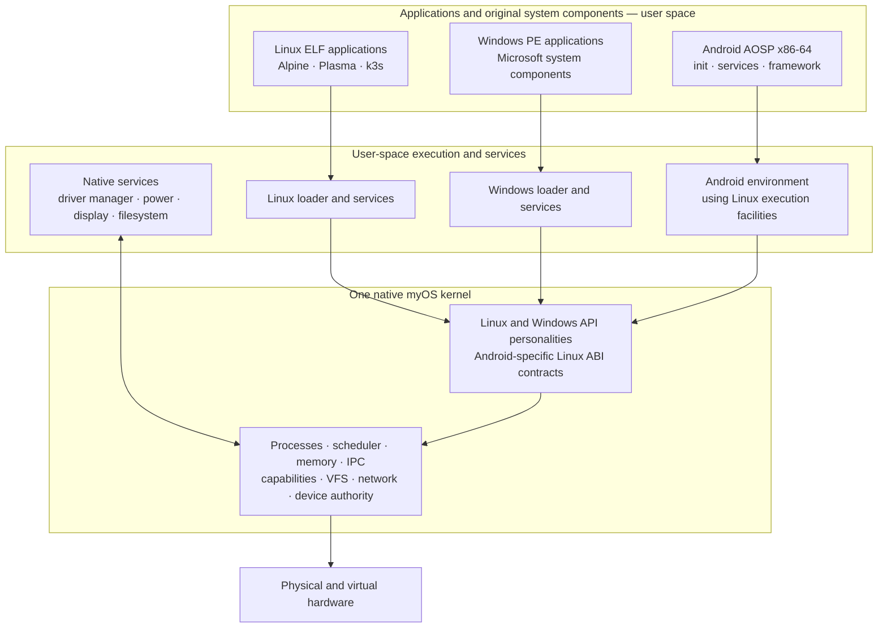
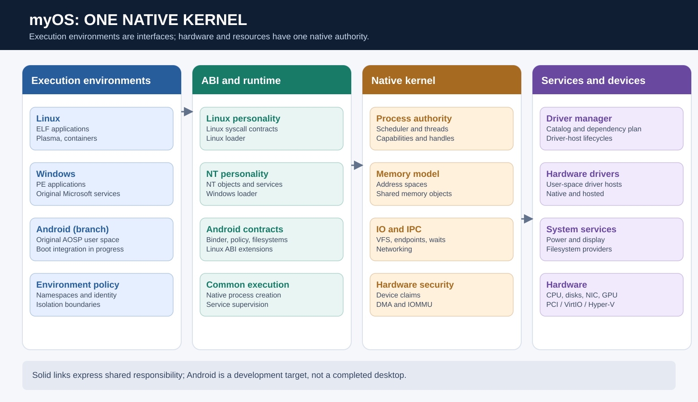

# myOS — System architecture

**Architecture assessment · 9 October 2026**

myOS is an independently developed operating system built around a native x86-64 kernel. Its defining design choice is to host multiple operating-system execution environments on **one kernel** instead of using a virtual machine, a second kernel, or a translation layer that owns the machine. Native operating-system mechanisms are shared; each environment supplies the process-facing contract expected by its applications.

## At a glance

### What 'native' means

There is one authority for processes, memory, hardware, networking and storage. Linux-compatible programs do not run in a Linux virtual machine; Windows applications are loaded as Windows executable images against their expected NT interfaces; Android is being introduced as a separate AOSP user-space environment. Compatibility is not identical to completeness: each environment must implement the contract that its unmodified software needs.

### Responsibility boundaries

| Layer | Responsibility | Intentionally does not own |
|---|---|---|
| Native kernel | Scheduling, memory, protection, device ownership, IPC, shared system resources | Application framework policy or hardware-driver business logic |
| Compatibility personality | Linux or NT process-facing conventions and calls | A separate resource manager or kernel |
| Execution environment | Image loading, process startup, original user-space components | Exclusive ownership of the machine |
| Native service | Device management, policy, presentation, power and other delegated responsibilities | A private operating-system namespace unrelated to kernel authority |
| Driver host | Running device-specific logic within a confined process | Arbitrary physical-memory access |

## Why a shared kernel matters

A virtual-machine approach duplicates kernel-level operating-system machinery, then connects the separate systems through virtual devices. myOS instead keeps a single native representation of a process, a memory object, a channel, a device and a mount. Environment-specific semantics are projected onto those objects. This gives applications different interfaces to the **same underlying machine**, while making isolation and authority critical design requirements.

## Architectural principles

1. **Mechanism before personality:** implement a generic system facility once when more than one environment can use it.
2. **Preserve original user space:** run unmodified Linux, Microsoft and AOSP components where feasible, rather than recreating higher-level frameworks.
3. **Keep drivers outside the kernel:** device ownership and resource authorization remain native; the driver logic executes in user space.
4. **Authority follows capabilities:** possession and scope of a permitted resource are explicit and revocable.
5. **Distinguish design, implementation and proof:** a compiled component is not a successfully booted or validated subsystem.

## Current maturity

Linux is the most established environment in the reviewed material, with real workload evidence for desktop and container infrastructure. The Windows environment can execute authentic Microsoft user-space components and has reached substantial service initialization, but full desktop and driver compatibility remain ongoing. Android is an active implementation: original AOSP boot has reached enforcing SELinux and a subset of services; the complete application and display acceptance scenario has **not** been demonstrated.

**Review date:** 9 October 2026. This is an architectural interpretation, not an independently successful full-system acceptance run.

---

## Engineering cross-section and design invariants

The architecture has three independent boundaries. The **privilege boundary** separates ring-0 authority from ring-3 services. The **ABI boundary** gives Linux, Windows and Android their expected process-facing contracts. The **resource boundary** determines what particular processes may access or delegate. Confusing these boundaries risks turning an API compatibility layer into a second resource authority.

A process is not trusted simply because it belongs to a particular operating-system environment. Drivers likewise do not gain unrestricted machine access because they need to program a device. The native kernel resolves resource identity and capability scope first; the environment translates the resulting behavior into its own conventions.

### Generic mechanisms versus operating-system semantics

| Question | Native ownership | Environment ownership |
|---|---|---|
| Who owns a process? | Native process identity, address space, thread and lifecycle | PID/HANDLE presentation and environment-specific parent/child behavior |
| Who owns a file? | Filesystem/node identity, mount structure, rights | Linux path and flags; NT object paths; Android labels |
| Who owns a message? | Endpoint lifetime, transport and transfer authority | Linux protocol, NT ALPC format or Android Binder transactions |
| Who owns a network interface? | Native interface, network domains and routing mechanisms | Per-environment interface naming, controls and expected responses |
| Who owns a device? | Exclusive claim, MMIO, interrupt, DMA mapping and revocation | Driver-family-specific device behavior |

**Invariant:** one generic mechanism should not be reimplemented independently for each environment if it can be shared with faithful semantic adaptation. This is a design requirement, not proof that all legacy duplicate code has already been eliminated.

### Assessing architectural fitness

Successful execution of a system call is only the first layer of validation. A cross-environment architecture must also prove that object identity is stable, unauthorized peers cannot gain authority, error translation is exact enough for the original client, cancellation and process death release resources, and concurrent workloads from other environments continue to behave correctly.

Performance must similarly be decomposed into dispatch, scheduling, transport, copying, driver execution and hardware completion. A single kernel removes the need for guest-to-host VM transitions, but ring-3 services can still introduce expensive back-and-forth messaging or serialization.

### Important architectural tension

The kernel must expose sufficiently powerful primitives to support authentic Linux, NT and Android contracts without accumulating three independent operating systems inside ring 0. That is why native object and capability design is more consequential than the number of compatibility entry points.
