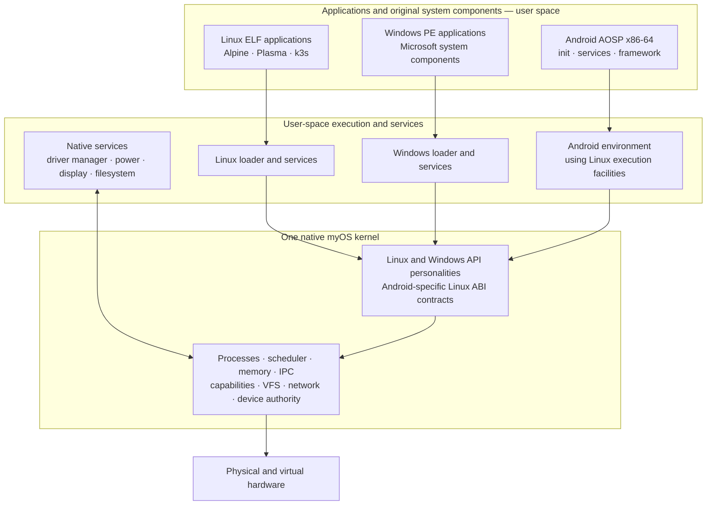

# myOS — System architecture

**Architecture assessment · 9 October 2026**

myOS is an independently developed operating system built around a native x86-64 kernel. Its defining design choice is to host multiple operating-system execution environments on **one kernel** instead of using a virtual machine, a second kernel, or a translation layer that owns the machine. Native operating-system mechanisms are shared; each environment supplies the process-facing contract expected by its applications.

## At a glance

### What 'native' means

There is one authority for processes, memory, hardware, networking and storage. Linux-compatible programs do not run in a Linux virtual machine; Windows applications are loaded as Windows executable images against their expected NT interfaces; Android is being introduced as a separate AOSP user-space environment. Compatibility is not identical to completeness: each environment must implement the contract that its unmodified software needs.

### Responsibility boundaries

| Layer | Responsibility | Intentionally does not own |
|---|---|---|
| Native kernel | Scheduling, memory, protection, device ownership, IPC, shared system resources | Application framework policy or hardware-driver business logic |
| Compatibility personality | Linux or NT process-facing conventions and calls | A separate resource manager or kernel |
| Execution environment | Image loading, process startup, original user-space components | Exclusive ownership of the machine |
| Native service | Device management, policy, presentation, power and other delegated responsibilities | A private operating-system namespace unrelated to kernel authority |
| Driver host | Running device-specific logic within a confined process | Arbitrary physical-memory access |

## Why a shared kernel matters

A virtual-machine approach duplicates kernel-level operating-system machinery, then connects the separate systems through virtual devices. myOS instead keeps a single native representation of a process, a memory object, a channel, a device and a mount. Environment-specific semantics are projected onto those objects. This gives applications different interfaces to the **same underlying machine**, while making isolation and authority critical design requirements.

## Architectural principles

1. **Mechanism before personality:** implement a generic system facility once when more than one environment can use it.
2. **Preserve original user space:** run unmodified Linux, Microsoft and AOSP components where feasible, rather than recreating higher-level frameworks.
3. **Keep drivers outside the kernel:** device ownership and resource authorization remain native; the driver logic executes in user space.
4. **Authority follows capabilities:** possession and scope of a permitted resource are explicit and revocable.
5. **Distinguish design, implementation and proof:** a compiled component is not a successfully booted or validated subsystem.

## Current maturity

Linux is the most established environment in the reviewed material, with real workload evidence for desktop and container infrastructure. The Windows environment can execute authentic Microsoft user-space components and has reached substantial service initialization, but full desktop and driver compatibility remain ongoing. Android is an active branch: original AOSP boot has reached enforcing SELinux and a subset of services; the complete application and display acceptance scenario has **not** been demonstrated.

**Evidence base:** myOS master architecture and subsystem documentation, and Android branch `claude/android-x86-64-native-624c9f` (reviewed 9 October 2026). This is an architectural interpretation, not an independent successful full-system acceptance run.
