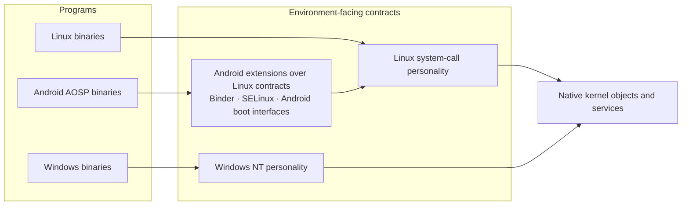
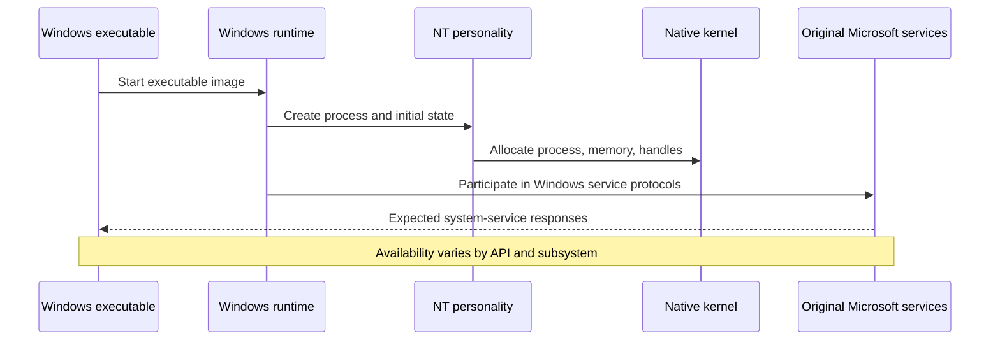
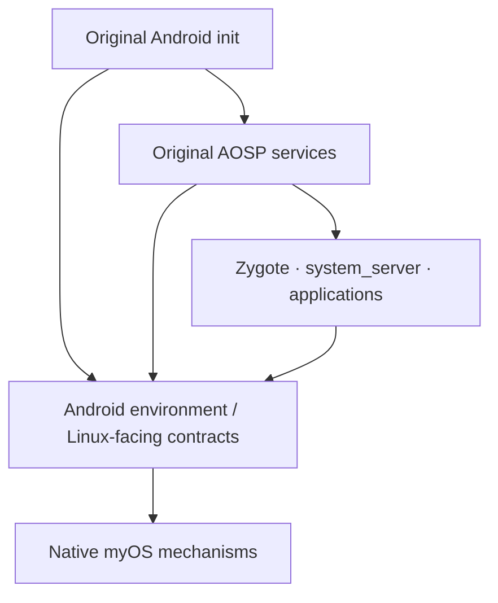

# Execution environments: Linux, Windows and Android

myOS does not divide the computer into three machines. It divides the **interfaces applications expect** while retaining one native process and resource model.



## Linux

Linux executable files use a Linux-compatible runtime and system-call interface. The documented implementation covers process execution, memory mappings, threading, files, signals, sockets, virtual filesystems, namespaces and container-related facilities. Some Linux-formatted system information is generated by user-space services from generic native measurements, avoiding Linux-specific text generation inside the native infrastructure.

Evidence includes Alpine workloads, Wayland/Plasma integration and k3s experiments. A particular tested workload is not proof of universal Linux binary compatibility.

## Windows

Windows executable images are PE files, loaded with a Windows-focused runtime. The environment supplies NT-facing process, handle, object namespace, synchronization, registry, IPC and system interfaces. The design deliberately uses original Microsoft system binaries sourced from a separately installed Windows environment. The aim is to **support Windows software**, not to reimplement or redistribute Windows itself.



Windows service startup, native ALPC backing, GUI and original Windows driver integration are ongoing work. The existence of an NT-facing object or API is not sufficient evidence that every Windows dependency is operational.

## Android: third environment, not a third kernel

The separate Android development effort adds **original x86-64 AOSP user space**, using the established Linux execution path while extending its contracts for Android. Android-specific requirements include first- and second-stage initialization, Binder communication, SELinux enforcement, property and filesystem behavior, cgroups, eBPF networking, graphics and device presentation.



**Observed, not merely planned:** the 9 October Android architecture audit reports a boot reaching the original SELinux policy in enforcing mode, with init, ueventd, apexd, logd, servicemanager, vold and selected security services running. It reports a stop at bpfloader; zygote, system_server, SurfaceFlinger, netd and adbd had not started in that verified run. The audit also reports no full regression pass on the implementation. Consequently, Android app installation, launch, graphical interaction and uninstall are **acceptance goals**, not completed demonstrations.

## Shared design, separate contracts

A Linux process and a Windows process should ultimately be native processes subject to the same scheduling, memory protection and hardware authority. Their interfaces and process-visible representations can differ. Android adds its own isolated environment and Binder boundary; Binder is not intended as a universal cross-environment API.

**Key limitation:** the public phrase 'runs Linux, Windows and Android' describes three architectural targets at different maturity levels, not a claim of complete product compatibility today.

---

## The complete compatibility chain

```text
  Original executable / service
                 |
       Image recognition and loader
                 |
       Dynamic runtime + dependencies
                 |
       Native process and thread objects
                 |
       Personality-specific ABI semantics
                 |
       Service discovery + IPC + security
                 |
       Filesystem, devices, network, graphics
                 |
       Visible result + orderly termination
```

Each layer can fail independently. Loading a PE image is not equivalent to completing Windows service startup; executing AOSP init is not equivalent to launching an Android application.

### Linux as a projected machine view

The Linux environment exposes expected Linux process operations, filesystem views, namespaces and container-related interfaces over native objects. System information presented in Linux formats can be generated by specialized ring-3 services using native counters. This helps prevent the Linux personality from becoming the only authoritative description of the machine. Containers multiply *views* and security contexts; they do not create independent kernels.

### Windows as genuine user space over NT contracts

The architecture uses original Microsoft binaries obtained from the user's own installation media. Microsoft components perform substantial user-space work including service orchestration, runtime loading, session creation and portions of process bootstrap. myOS must provide compatible NT objects and transport underneath them, not invent artificial 'running' states that let one service pass while leaving its dependent subsystem absent. Native ALPC backing is useful only if Windows object identity, message semantics, security, deadlines and completion behavior all agree sufficiently with the original clients.

### Android as a third environment

Android is more than ELF plus Linux syscalls. Original AOSP first-stage boot, system properties, SELinux policy, APEX, Binder, network initialization, framework lifecycle and composition form a dependency chain. The Android implementation extends the Linux-facing interface and uses shared kernel primitives. It deliberately does not boot Android's Linux kernel and does not substitute its own framework or PackageManager.

The reviewed implementation reaches enforcing SELinux and several authentic system services. The audited run stops before zygote and SurfaceFlinger; therefore the existence of the graphics implementation is not yet proof that Android applications appear in Plasma.

### Coexistence acceptance

Run Linux desktop and services, original Windows services, and Android startup concurrently while applying memory pressure, process termination, device removal, I/O cancellation and network-policy changes. Measure whether the common kernel continues to enforce boundaries and whether one environment's failure cascades into the others. The reviewed documentation does not yet establish that this full matrix passes.

## PE loading: implementation update (22 October 2026)

The Windows executable-loading implementation supports both PE32+ (AMD64) and PE32 (I386) image handling, with separate responsibilities for parsing, module dependency resolution and process construction. WOW64-related process and thread mechanisms are also present. This is an implementation review, not proof of arbitrary 32-bit application compatibility or a new regression-test result.
