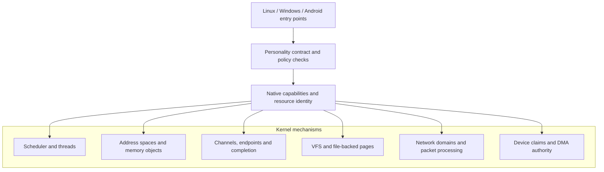
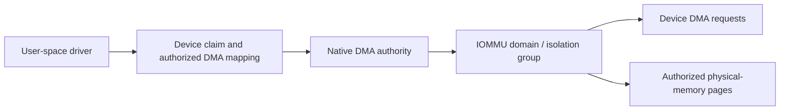

# Native kernel, isolation and security

The native kernel is the common operating-system authority. It provides process and thread identity, scheduling, virtual memory, synchronization, IPC, files, networks and device-resource access. The execution environments translate their APIs to these facilities.

## Process and memory model

Processes use native address spaces and memory objects. Executable loading and mapping are separated from the core ownership model. Multicore scheduling, synchronization, wakeups and virtual-memory translation are kernel services, not implementations duplicated by each personality. File-backed memory and page-cache integration are intended to avoid unnecessary independent copies of identical file contents.

## Communication and synchronization

Native channels, endpoints, readiness, wait mechanisms and completion facilities form the underlying transport. Linux sockets, pipes, event facilities and Windows ALPC/NT wait contracts project their respective semantics onto native primitives. This allows the transport and resource lifetime to be reviewed independently from an operating-system-specific message format.

## Capability-oriented authority

A process can operate on a resource only within the rights available to it. Device claims, mappings and interrupt delegation are specific examples. Driver termination must release ownership rather than leave unrestricted access behind.

## Hardware-backed DMA isolation

Intel VT-d and AMD-Vi support are documented as exercised on emulated IOMMU hardware. The **isolation group** is the real hardware boundary: devices that hardware cannot distinguish may share a translation domain, even when owned by different driver processes. On configurations without an IOMMU, software ownership checks cannot provide the same protection from malicious device DMA. Physical-hardware coverage is not established by the emulated tests.

## Protection and policy

The documented design includes address-space protections and mitigation work, security-aware process authority, and environment-specific access-control enforcement. Android additionally requires enforcement of its original SELinux policy. Protection properties must be evaluated end-to-end; adding an API does not automatically prove containment across every environment.

## Current risks

The Android branch audit identifies pending environment-isolation issues involving writable machine-wide configuration, some globally visible metadata, incomplete peer-domain checks for selected devices, and unverified regression behavior. These are material integration risks, not generic theoretical caveats. The kernel should be described as architecturally security-conscious, **not certified secure**.
