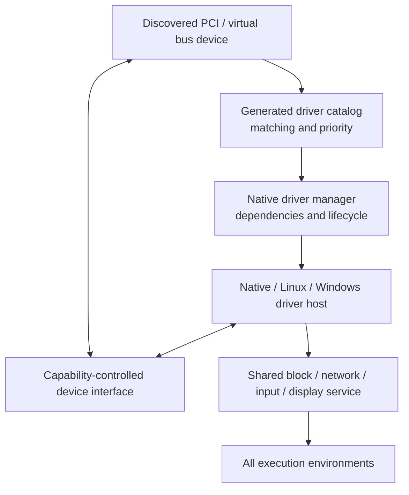
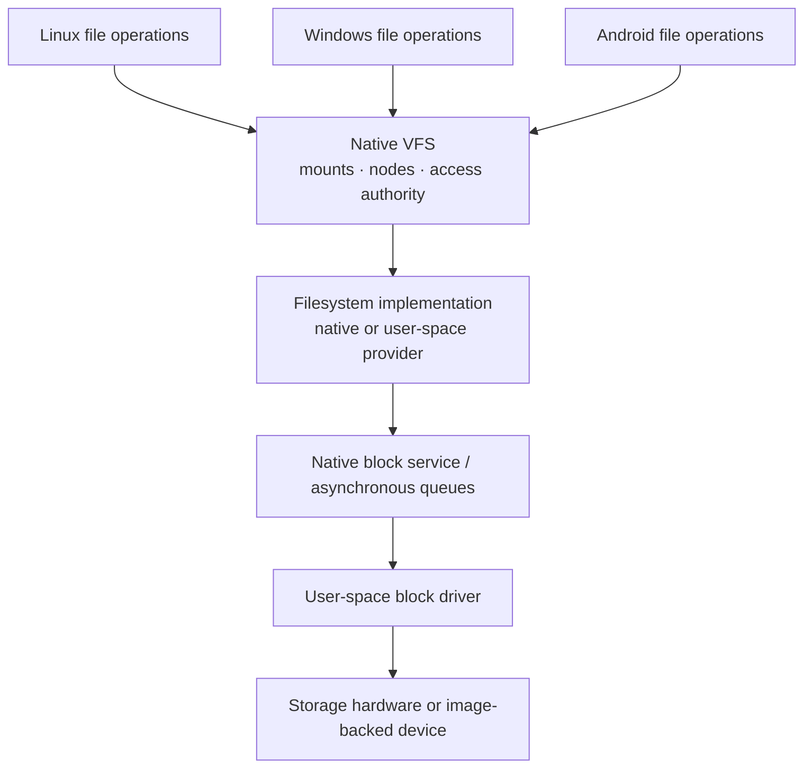

# Drivers, storage, networking and display

## One driver-management model

Hardware discovery, driver selection, dependency planning and lifecycle supervision are native services. The driver manager selects a compatible driver from a generated catalog. The selected driver runs through a host appropriate to its origin: native, hosted original Linux code, or the developing Windows driver host. All must obtain hardware authority through the same native device boundary.

Original Linux source drivers have been hosted in user space in actual device tests, including VirtIO and some Hyper-V paths. Other discovered or buildable drivers are not necessarily runnable. Windows WDM-style hosting and original Microsoft driver functionality are still being connected: a driver host existing in the architecture does not establish that a specific original Windows driver can start and operate.

## Storage and filesystem architecture

A native virtual filesystem separates name resolution, mounts and file identity from individual filesystem formats. Native and hosted filesystem providers can serve it. Native ext4 storage, memory-backed filesystems, file-backed memory and provider-based read-only ISO9660/UDF have documented evidence. The Android branch adds requirements for EROFS images, file-backed block devices, partition views and Android file labels.

The storage architecture aims to preserve one file and storage identity beneath multiple operating-system views. A successful Linux filesystem operation is not, by itself, evidence of complete NT filesystem semantics.

## Networking

The kernel owns native network interfaces, transport and packet processing; Linux presents sockets, interfaces, namespaces and Linux network-control conventions. Hosted original Linux network drivers can feed the common network service. Other environments should consume the same underlying connectivity, with their own visible configuration and APIs. Filter rules, network domains and authority need to remain generic so that no compatibility environment silently controls global machine networking.

## Graphics

The existing Linux desktop path uses a native user-space GPU/display service exposed through Linux DRM/KMS and a Wayland desktop. The Android branch proposes an isolated virtual DRM output, original SurfaceFlinger and hardware composer, and a bridge that makes Android's output appear as a Wayland window.

**Status distinction:** the Android display architecture was described as implemented and compilable in its subsystem design document, but not boot-tested. The subsequent branch audit likewise says that the complete graphics chain has not run. It must not be presented as a demonstrated graphical Android session.

## Power management

A native power service owns policy and delegates hardware mechanisms to ACPI-oriented services and authorized kernel primitives. Shutdown/reboot have QEMU/OVMF evidence; suspend and hibernation are not complete, and the Windows power interface is not yet fully backed by the native service.
