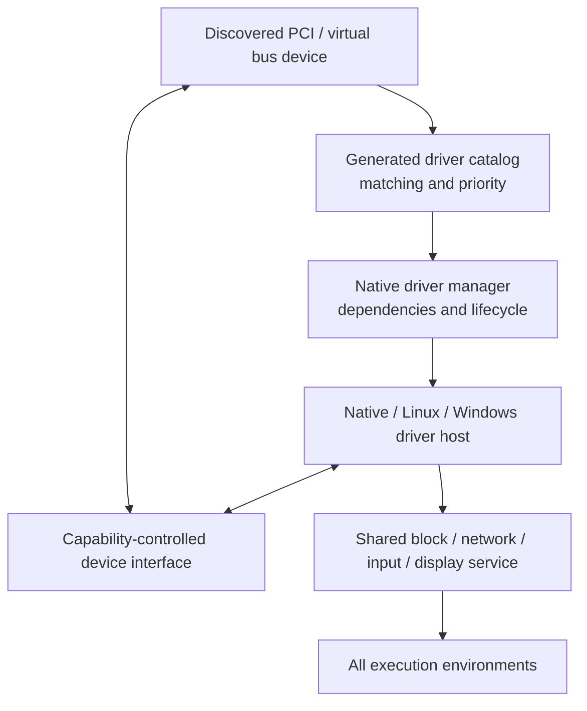
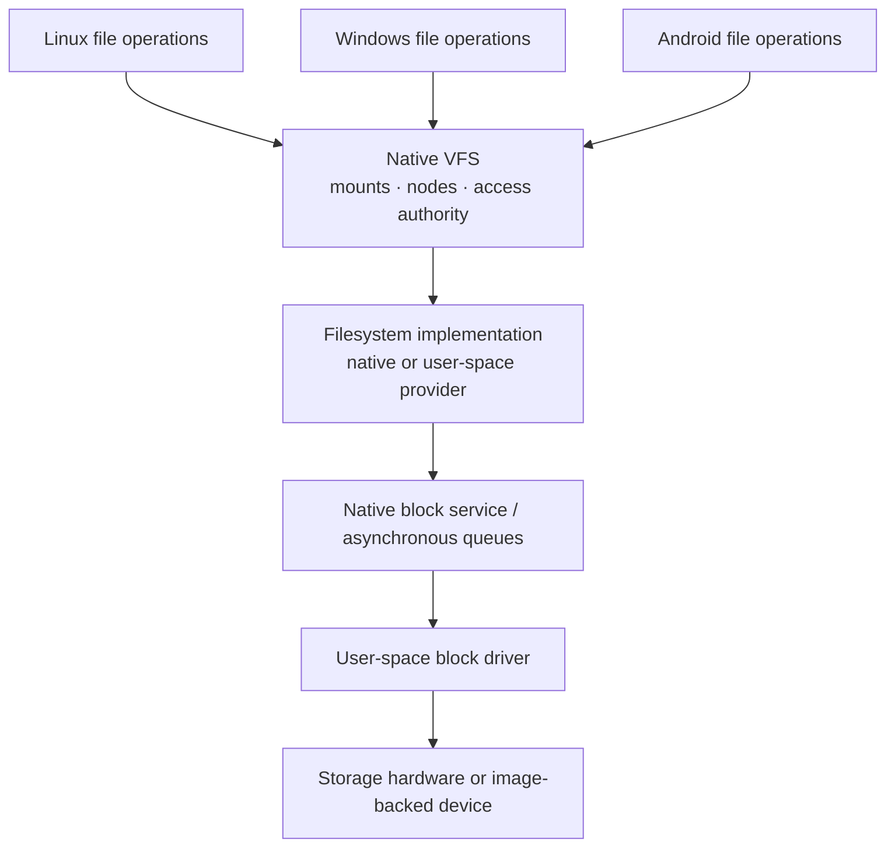
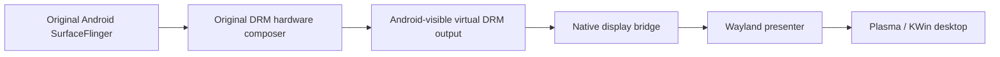
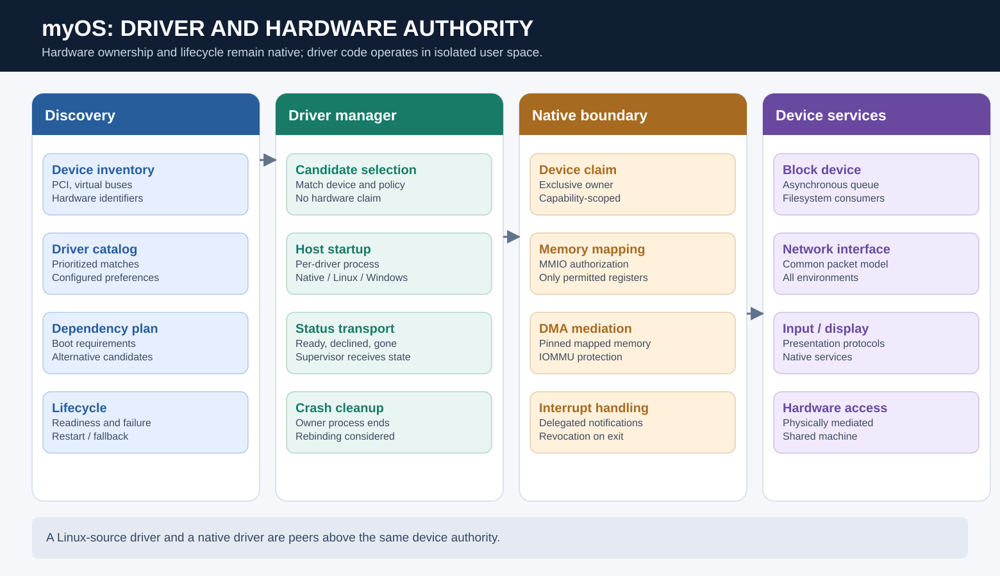
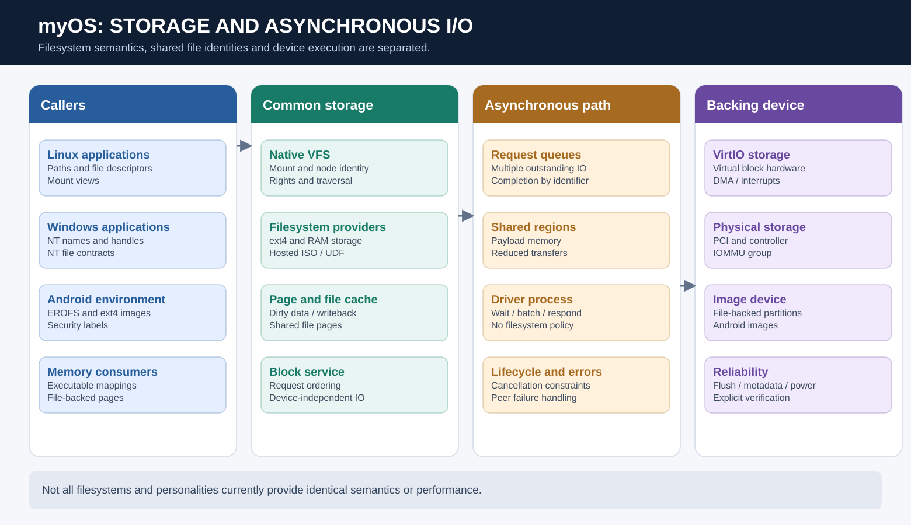
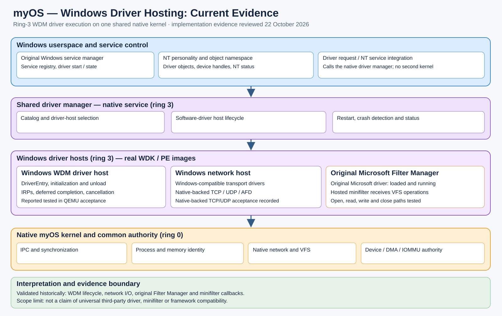

# Drivers, storage, networking and display

## One driver-management model

Hardware discovery, driver selection, dependency planning and lifecycle supervision are native services. The driver manager selects a compatible driver from a generated catalog. The selected driver runs through a host appropriate to its origin: native, hosted original Linux code, or the developing Windows driver host. All must obtain hardware authority through the same native device boundary.



Original Linux source drivers have been hosted in user space in actual device tests, including VirtIO and some Hyper-V paths. Other discovered or buildable drivers are not necessarily runnable. Windows WDM-style hosting and original Microsoft driver functionality are still being connected: a driver host existing in the architecture does not establish that a specific original Windows driver can start and operate.

## Storage and filesystem architecture

A native virtual filesystem separates name resolution, mounts and file identity from individual filesystem formats. Native and hosted filesystem providers can serve it. Native ext4 storage, memory-backed filesystems, file-backed memory and provider-based read-only ISO9660/UDF have documented evidence. The Android implementation adds requirements for EROFS images, file-backed block devices, partition views and Android file labels.



The storage architecture aims to preserve one file and storage identity beneath multiple operating-system views. A successful Linux filesystem operation is not, by itself, evidence of complete NT filesystem semantics.

## Networking

The kernel owns native network interfaces, transport and packet processing; Linux presents sockets, interfaces, namespaces and Linux network-control conventions. Hosted original Linux network drivers can feed the common network service. Other environments should consume the same underlying connectivity, with their own visible configuration and APIs. Filter rules, network domains and authority need to remain generic so that no compatibility environment silently controls global machine networking.

## Graphics

The existing Linux desktop path uses a native user-space GPU/display service exposed through Linux DRM/KMS and a Wayland desktop. The Android implementation proposes an isolated virtual DRM output, original SurfaceFlinger and hardware composer, and a bridge that makes Android's output appear as a Wayland window.



**Status distinction:** the Android display architecture was described as implemented and compilable in its subsystem design document, but not boot-tested. The subsequent technical review likewise says that the complete graphics chain has not run. It must not be presented as a demonstrated graphical Android session.

## Power management

A native power service owns policy and delegates hardware mechanisms to ACPI-oriented services and authorized kernel primitives. Shutdown/reboot have QEMU/OVMF evidence; suspend and hibernation are not complete, and the Windows power interface is not yet fully backed by the native service.

---

## Device paths in detail



The driver catalog performs constant-time exact matching of device-identification keys and applies preference, specificity and policy ordering to candidates. Matching is distinct from claiming: catalog lookup should never program hardware. The selected host then requests an exclusive device claim and maps only the resources granted by the native device interface. This makes driver origin a hosting decision rather than a separate hardware-security model.

### Interrupts, DMA and lifecycle

A user-space driver can safely operate real hardware only if device memory access, bus mastering, interrupts and DMA are mediated. The native kernel owns those mappings and their cleanup. A crashing driver should not leave a device permanently claimed or allow its subsequent DMA to write memory formerly belonging to its process.

### Storage and file-backed memory



The native VFS is the common entry point beneath Linux and NT file conventions. A filesystem provider implements filesystem-specific lookup and content semantics; the block layer handles device-independent requests; an asynchronous queue connects it to a user-space device driver. Shared regions can avoid copying payloads at every process boundary, but their lifetime, alignment, ownership and coherency must be defined.

File-backed memory unification matters for executable startup and shared libraries. Historically separate whole-file image caches, writeback caches and shared mappings can cause duplicated memory use or stale observations. The intended native page model gives mappings a coherent underlying file identity. Complete cache coherency, truncate/writeback interactions and power-failure durability still need workload-specific proof.

### Asynchronous block I/O

```text
  Filesystem / cache            Shared queue                   Driver process
  ------------------            ------------                   --------------
  Submit request -------------> request descriptor
  Keep request identity         shared data region -----------> submit hardware IO
  Continue other work                                         -> await interrupt
                                completion descriptor <------- result and status
  Reap completion <------------
  Translate to caller contract
```

The queue design supports multiple outstanding requests and out-of-order completion. The existing design documentation identifies cancellation, timeout and priority semantics that are specified but not universally consumed by the classes. Large request throughput is not sufficient evidence of stable tail latency under filesystem metadata load.

### Network policy boundaries

The network dataplane, interfaces and routing authority remain common. Linux netlink or filtering tools are presentations and configuration mechanisms for that underlying state. Windows network control and Android eBPF behavior should ultimately converge on native capabilities, but each API must preserve its own contractual semantics. The fact that network packets move does not prove that every network-management interface works.

### Original graphics composition

Android's planned path uses original SurfaceFlinger and hardware composer against a virtual DRM/KMS device, then hands an output to a native display bridge and Wayland presenter. This preserves ownership of Android composition inside AOSP and of host desktop composition inside KWin. The graphical chain in the reviewed Android implementation is implemented but not end-to-end demonstrated.


## Windows driver execution — additional development effort (9 October 2026)

The separate Windows-driver implementation contains functioning **ring-3 WDM driver hosting** under the shared driver manager. Its WDK-built test driver is reported to run with real DriverEntry, IRP completion, cancellation and host-crash recovery. The implementation additionally exercises myOS-built Windows-compatible transport drivers against the native network stack through a Windows network driver host. These are not just NT device objects displayed to Windows applications.



The original Microsoft **Filter Manager** runs in the Windows driver-host environment. Reported acceptance tests demonstrate successful initialization and native filesystem operations reaching a hosted minifilter through the shared VFS. This does not imply universal compatibility with every filesystem filter. See [Windows driver-host implementation](09-windows-driver-runtime.md) for the exact evidence and scope.
