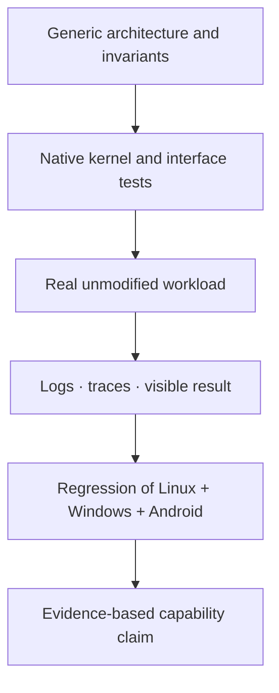

# Validation, evidence and open integration work

myOS is an active operating-system research and engineering project. The most meaningful progress measures are **observable original workloads**, consistency of shared kernel mechanisms and reproducible tests—not source size or the number of named APIs.

## Evidence terminology

| Label | Meaning |
|---|---|
| Demonstrated | Original workload or targeted test executed and produced observable evidence |
| Implemented, not demonstrated | A path exists and may compile, but end-to-end operation was not established |
| In progress | Missing contracts, partial execution or known blockers |
| Planned | Design target without a validated implementation |

## Current assessment, 9 October 2026

| Area | Assessment | Caveat |
|---|---|---|
| Native process/memory/IPC foundation | Demonstrated in extensive subsystem and workload activity | Full correctness is not proven by subsystem tests |
| Linux execution | Demonstrated with substantial real workloads | Not universal Linux compatibility |
| Linux-hosted user-space drivers | Demonstrated for selected devices | Many device families still require validation |
| IOMMU / DMA isolation | Demonstrated on emulated Intel and AMD IOMMUs | Physical-hardware testing remains distinct |
| Windows execution and services | Demonstrated progressively using original binaries | Original driver and desktop coverage remain incomplete |
| Native filesystem and block paths | Demonstrated for selected filesystem and driver configurations | Edge cases and performance issues remain |
| Android first/second-stage boot | Demonstrated in part on the Android development branch | Stops at bpfloader in the cited validated run |
| Android desktop and application lifecycle | Not demonstrated | Zygote, framework, graphics and adb acceptance incomplete |
| Cross-environment integration | Architectural goal with partial implementation | Isolation and whole-system regressions need proof |

## End-to-end validation model



The Android audit explicitly reports that the branch had no green full-regression run at its review point. It also identifies a deterministic test issue and stack-overflow investigation, security-isolation gaps, a non-working bpfloader boot step and unproven eBPF JIT behavior. These observations outweigh any claim that the full Android runtime already works.

## Immediate engineering priorities

1. Stabilize the shared kernel and rerun comprehensive multicore and cross-environment regression tests.
2. Resolve the Android boot blocker, then demonstrate zygote, system_server, SurfaceFlinger and adb in sequence.
3. Validate security boundaries between execution environments, including device access, machine-wide settings and peer-domain checks.
4. Complete real Windows driver and desktop service integration without duplicating native kernel facilities.
5. Continue end-to-end latency, driver crash/recovery and hardware platform validation.

## Interpretation

The strongest aspect of myOS is architectural coherence: the machine remains owned by one kernel, while the operating-system contracts and driver runtimes are separable. The primary challenge is not adding another compatibility API in isolation; it is preserving this shared model while proving all three execution environments can coexist under realistic workloads.

This document does **not** assert formal security certification, complete Windows support, general Android application compatibility or readiness for general-purpose production deployment.

---

## Engineering acceptance methodology

Compatibility claims need a chain of independently repeatable evidence:

```text
  Design invariant
       |
  Unit / kernel subsystem tests
       |
  Real original binary or device workload
       |
  Failure and restart injection
       |
  Cross-environment concurrency / isolation
       |
  Repeated runs across CPU counts and platforms
       |
  Public statement of what was actually observed
```

### Interpreting measured progress

An *implemented* subsystem has a corresponding design and implementation path. A *tested* subsystem has one or more direct tests. A *workload-demonstrated* subsystem has executed a relevant original program or driven hardware in a real scenario. A *system-validated* subsystem must additionally survive regression, concurrency and failure scenarios. These are separate milestones.

### Validation matrix

| Dimension | Minimum representative evidence |
|---|---|
| Scheduler and wait | Multicore wakeup, migration, cancellation and process-exit stress |
| Filesystem and storage | Metadata-heavy workloads, writeback, flush, unmount, read-only providers |
| Driver model | Real device, failure/restart, ownership release, DMA isolation |
| Linux personality | Original applications, shell, desktop and container/network workloads |
| Windows personality | Original Microsoft process startup, service dependencies, RPC, device functionality |
| Android branch | Original boot, enforced MAC, APEX, network initialization, framework, graphical app |
| Coexistence | Parallel environments plus boundary abuse and resource exhaustion |

### Material unresolved integration risks

At the reviewed point, the Android audit reports absent green full regressions and a boot stop in network initialization. The Windows original driver-host model has outstanding integration with the driver-specific NT contracts. Generic IPC readiness and completion work remains subject to specific verification criteria, and storage/caching reviews identify edge-case debt. Public status descriptions must keep these limitations attached to any performance or compatibility claims.

### Roadmap principle

Prioritize foundational correctness and cross-environment regression ahead of accumulating features. One correct native primitive improves all environments; an expedient per-environment duplicate imposes long-term semantic and maintenance cost.
