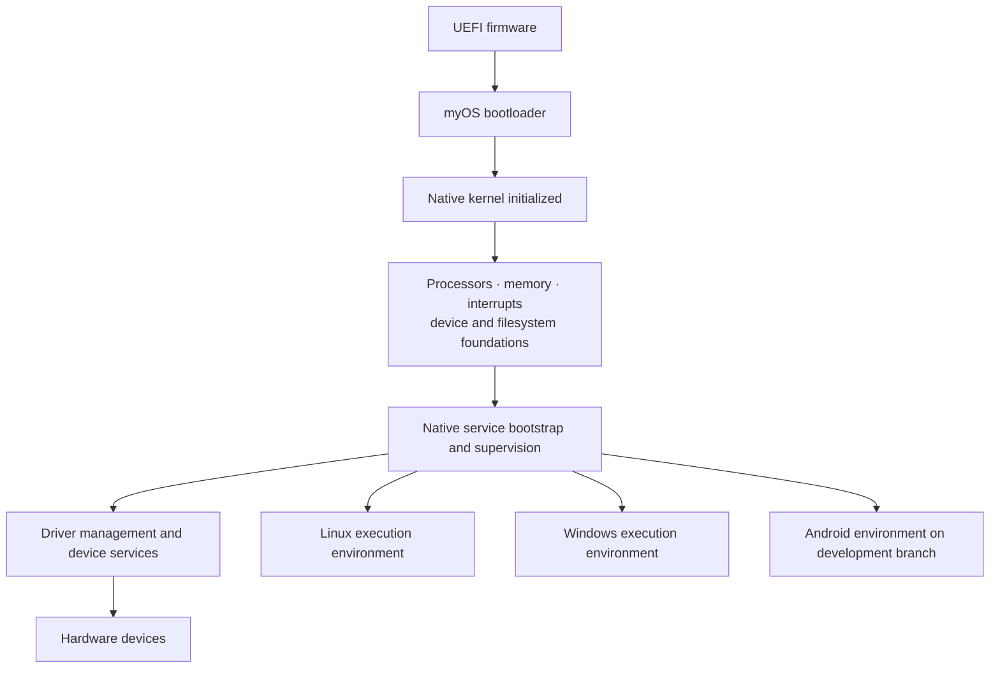
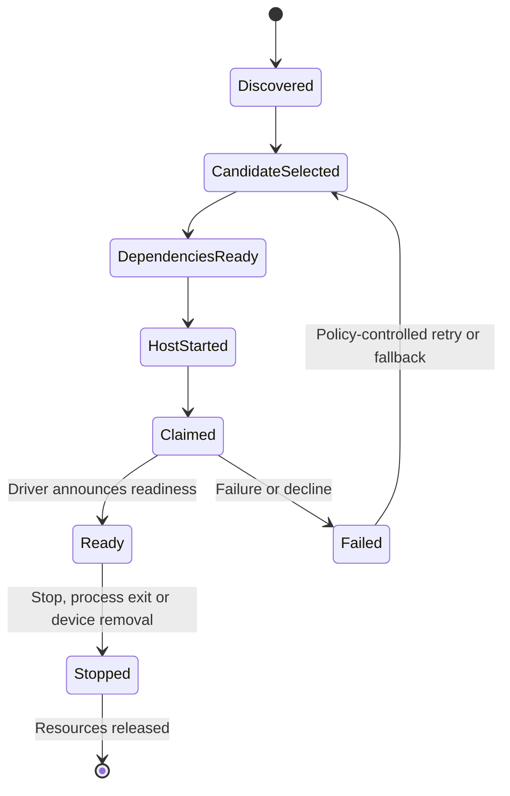
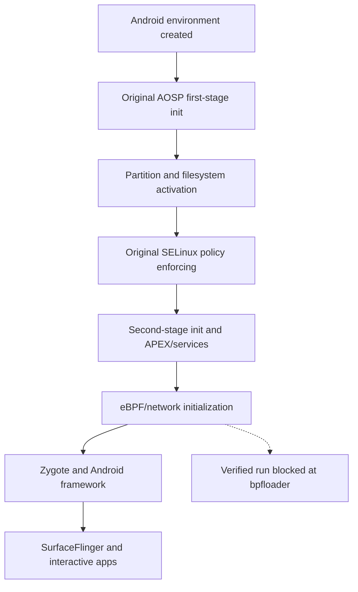

# Boot and service lifecycle

## From firmware to multiple environments

The native boot sequence establishes ownership of the machine before any compatibility environment starts. The bootloader hands control to the kernel; hardware discovery and kernel resource initialization establish the foundations for user-space services. The native service manager and loader are responsible for starting the appropriate infrastructure, rather than making a Linux or Windows environment the master operating system.

The diagram describes responsibility and dependency, not an asserted universal strict startup ordering. Services that have independent prerequisites can be launched without an artificial dependency on completion of an unrelated environment.

## Driver startup is dependency-driven

The driver manager matches discovered devices against a generated catalog, evaluates dependencies, launches the chosen driver host and tracks readiness or failure. A driver that declines or fails does not thereby acquire permanent ownership of the hardware. Claim release and process lifecycle are native responsibilities, allowing alternative or restarted drivers to be considered under the configured policy.

## Windows startup

Original Microsoft session-management and service components participate in Windows initialization; myOS provides the NT-facing objects, process facilities and native transport required by those components. Their progress is important evidence of compatibility, but dependency chains such as Windows service control, RPC, driver loading, filesystem filters and interactive session creation cannot be assumed complete merely because early services start.

## Android startup

Android starts its **own instance of the Linux execution environment**, then original AOSP first-stage and second-stage initialization run with Android-specific filesystem, device, security and environment contracts. The separate environment does not boot a GKI kernel. Its original AOSP services depend on successfully activating partitions, mandatory access control, system properties, Binder, networking and graphics.

In the reviewed 9 October Android audit, enforcing SELinux and a set of original services are demonstrable; bpfloader is the observed blocker. Framework and GUI startup shown afterward are **planned milestones, not demonstrated steps**.

## General design implication

Boot correctness should be measured as an explicit dependency graph and verified transitions, not simply as elapsed time until the first shell, first Windows service or first Android process. The isolation of each environment must remain intact during boot and during service failure.
