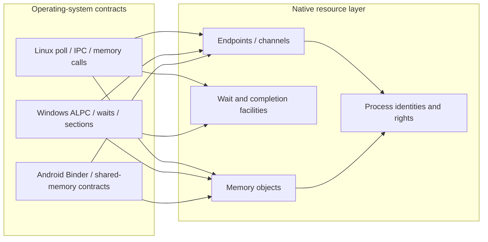
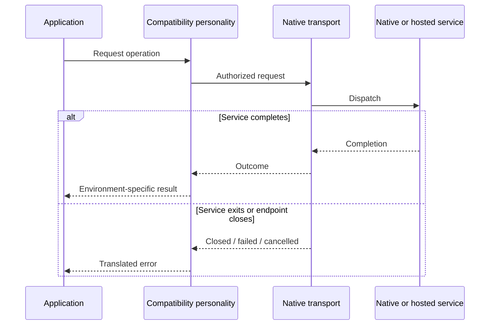

# IPC, process identity and shared resources

A multi-environment operating system must reconcile different names and conventions for the same underlying concepts. myOS addresses this through shared native identities, handles, memory objects and communication mechanisms, alongside environment-facing representations.

## One mechanism, different vocabulary

| Native concept | Linux-facing example | Windows-facing example | Android relevance |
|---|---|---|---|
| Process and thread | Process/thread IDs, wait and signals | Process/thread handles and NT object identities | Android processes and app lifecycle |
| Memory object and mapping | mmap, shared memory | Sections and mapped views | ashmem-like needs, memfd and runtime memory |
| Native message or endpoint | Unix-like IPC and socket projections | ALPC and service protocols | Binder requires its own full ABI semantics |
| Readiness and completion | Poll/epoll and blocking waits | NT waits and I/O completion | Framework and service event loops |
| Native file identity | File descriptors and mount views | Handles and NT object paths | AOSP partitions, files and labelled objects |
| Network authority | Linux network interfaces and namespaces | NT-facing network configuration and sockets | Isolated Android network environment |

This is a conceptual mapping, not a claim that each cell is fully supported.

## Correctness requirements

**Identity:** An environment-visible identifier must resolve to the intended native object, including after a process exits or a handle is closed. Accidental reuse cannot grant access to the wrong process or resource.

**Lifetime:** Native references keep an object valid while authorized clients depend on it. Shutdown and crash cleanup revoke device ownership and settle outstanding communication safely.

**Wait semantics:** Lost wakeups, premature readiness and stale messages can prevent a whole environment from starting. Linux, NT and Android require different user-facing guarantees, yet must depend on consistently correct native synchronization.

**Authority:** IPC must not accidentally turn an ordinary handle into a way to operate on arbitrary peer processes. Sender identity, receiver authority and transferred rights remain explicit.

**Environment boundary:** Android Binder must preserve the semantics of Android services without becoming an unrestricted bridge into unrelated Linux or Windows processes. Linux namespaces and Android peer-domain isolation are additional context, not substitutes for native rights checks.

## Files and resource views

Mount topology can be native while each environment chooses its own filesystem root and pathname conventions. The same underlying file may be reachable through separate views; access rights and mount restrictions still follow the applicable authority and attachment context. Linux procfs and sysfs descriptions, Windows object names and Android-specific device paths are **presentations**, not competing ownership systems.

## Cross-environment failure model

The challenge is not just moving bytes between processes: it is correctly implementing cancellation, deadlines, error translation, lifetime, completion and backpressure without duplicating native transports. Reviews of the Windows session and Android regression work show why those details can determine system-wide progress.
