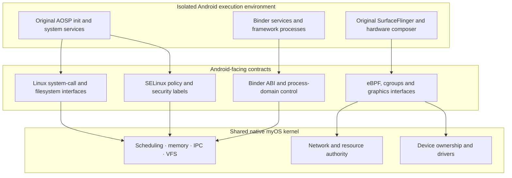
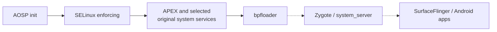
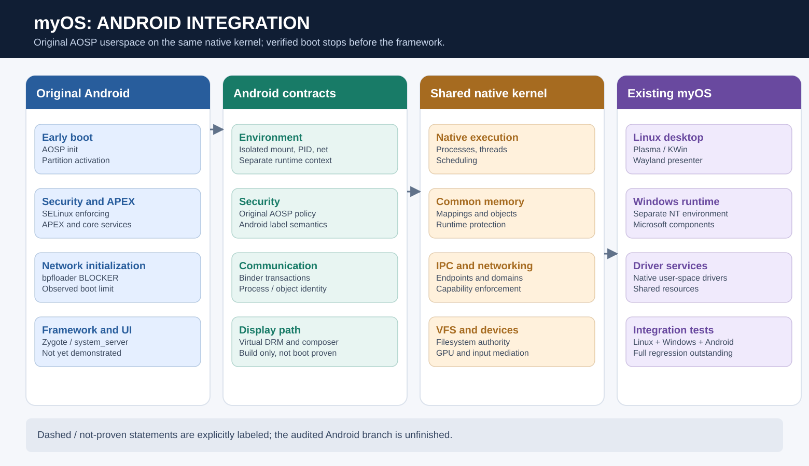

# Android on myOS: architecture and demonstrated maturity

**Review date:** 9 October 2026  
**Review basis:** Android architecture audit dated 9 October 2026

## Objective

Run the original **AOSP x86-64 user space** alongside Linux and Windows on the same native myOS kernel, without a second kernel, VM, Android framework replacement or extensive patches to the upstream platform. The target includes real Android initialization, system services, package installation, launching an interactive application inside the existing Plasma desktop, and correct package removal.

## Layered design

The Android-specific interfaces are primarily an extension of the existing Linux-facing environment. New reusable needs should be implemented as **native, environment-independent mechanisms** rather than embedding Android-specific behavior into every native subsystem.

## Original platform components

The implementation uses prebuilt Android images, including original AOSP platform partitions and system binaries. Android's first-stage boot, APEX management, policy loading, core services and graphical composition should be performed by the original components. A native installation mechanism provides the storage and bootstrap contracts the image requires. The Android kernel from the source image is **not** used.

## Key architectural dependencies

| Area | Required behavior |
|---|---|
| Filesystem and images | Read-only platform partitions, EROFS, writable Android data, file labels and by-name device presentation |
| Initialization | Correct boot parameters, mount operations, system properties and service dependencies |
| Security | Original SELinux policy, enforcing mode, domain isolation and rights enforcement |
| IPC | Binder identity, object and transaction semantics backed by native communication and process authority |
| Runtime | Process/thread scheduling, memory mappings, runtime memory protection and process groups |
| Networking | Android's expected eBPF and network-control behavior over shared native networking |
| Display | Original compositor and composer operating through a virtual DRM output |
| Host integration | Display and input bridging into the existing Linux desktop without taking over its GPU stack |

## Observed progress at audit time

The audit reports execution of init, ueventd, apexd, logd, servicemanager, vold, and selected keystore and hardware-backed security service interfaces. The reviewed boot sequence then encounters a **bpfloader failure**. There was no observed start of zygote, system_server, SurfaceFlinger, netd or adbd at that milestone.

Separately, the graphics bridge is documented as implemented and compiling in a development context; no end-to-end booted Android display had been measured. The latest reviewed implementation reviewed by the audit had not itself passed a full acceptance and regression run. These are separate evidence levels and should not be conflated.

## Integration risks

The technical review flags unresolved or insufficiently validated boundaries involving globally mutable settings, peer-domain isolation for selected devices, namespace-related process identification, Android memory objects and security labels, native scheduler regressions and eBPF execution. Some code paths were not boot-tested. These issues are especially important because regression can affect Linux and Windows even before Android reaches interactive startup.

## Next proof milestones

1. Full native kernel and existing Linux/Windows regression suite on the Android implementation.
2. Successful original Android network initialization beyond bpfloader.
3. Original zygote and system_server boot.
4. Original graphics composition shown through the desktop bridge.
5. Working adb package install, app start, interaction and uninstall.
6. Repeated tests under enforcing SELinux, including negative cross-environment isolation cases.

**Conclusion:** the third-environment architecture is materially implemented and early boot progress is demonstrated, but Android desktop and application compatibility remain **unfinished integration goals**.

---

## Android implementation: deeper system integration

### Image and boot ownership

The implementation inventories a prebuilt 64-bit AOSP image with platform and vendor partitions. The original Android kernel is not used. Instead, native myOS services expose the block and filesystem surfaces required by the AOSP ramdisk and partition layout. EROFS, metadata, extended attributes and security labels matter because original AOSP init and dynamic linking depend on the installed image's exact structure.

### SELinux as an end-to-end property

The observed enforcement milestone means the original policy was loaded and enforcing at that stage of startup. It does **not** guarantee correct labeling and access decisions for every subsequent memfd, device node, binder peer or virtual filesystem. These are precisely the areas where the audit identifies incomplete proof or behavior.

### Binder and process identity

Binder is not just a queue carrying serialized messages. It includes reference-counted remote objects, caller identity, thread scheduling interactions and transaction lifetime. Mapping this onto native IPC requires keeping Android-visible semantics while honoring native environment and capability boundaries.

### Networking and eBPF

The observed bpfloader failure blocks later startup dependencies. The Android design aims to run original AOSP eBPF objects and project network policy onto shared native mechanisms, but the audit states that successful original program load and execution had not been proven. A JIT-capable code path must not be confused with validated eBPF behavior; interpreter and JIT safety require distinct evidence.

### Display integration and authority

The implementation's planned graphics chain uses original SurfaceFlinger and DRM hardware composer, a virtual output, a display bridge and a Wayland presenter. Android composition is not replaced by an ad hoc myOS compositor. GPU ownership and display authority stay native; the Android environment sees an appropriate virtual card. The display chain was not boot-demonstrated in the audited run.

### Acceptance checklist

The next meaningful capability claim requires proof of original init and policy enforcement **plus** the original framework process chain, then a visible interactive app lifecycle. Linux and Windows regression must remain green at each step. This makes the third environment an integration test of the whole operating system, not a standalone demo.
