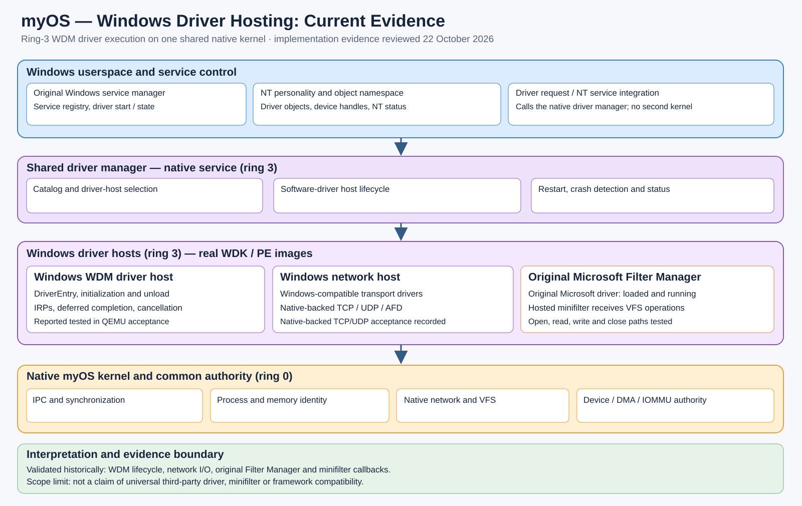

# Windows drivers on myOS — verified architecture and scope

Original Windows driver components run in user space behind the native hardware-authority boundary and an NT-compatible driver interface. Ongoing refinements to NT objects, access tokens, ALPC and system notifications may improve driver and service compatibility. Prior driver demonstrations apply only to their recorded hardware configurations.

**Evidence:** Recorded driver acceptance results describe particular tested configurations, not a fresh QEMU run.

## What exists

myOS includes a **Windows kernel-driver host running in ring 3**, an NT driver ABI runtime, and a shared native driver manager capable of starting software-driver hosts. The host loads relocatable PE/COFF Windows kernel-driver images, resolves imported NT kernel routines against its compatibility runtime, calls driver initialization and handles device objects and I/O requests. This is executable WDM driver hosting, not merely simulated Windows service status.

### Architectural ownership

| Layer | Responsibility |
|---|---|
| Original Windows user space and NT personality | Driver service requests, NT object names, handles and Windows status translation |
| Shared native driver manager | Catalog, host selection, starting/restarting and lifecycle |
| Ring-3 Windows driver host | PE driver loading, NT imports, DriverEntry, unload, IRP handling |
| Native myOS kernel | Processes, memory objects, waits/IPC, networking and hardware authority |
| Hardware or native class services | Common devices and network transport, independent of driver family |

The Windows driver host does not introduce a second kernel. Software drivers can run without owning a physical PCI device; network drivers use the native network mechanisms.

## What is reported as tested

The technical review documents a QEMU run of a **WDK-built WDM test driver**, including entry/unload, duplicate and concurrent loading, device names and links, synchronous/deferred IRPs, cancellation, reload and recovery from a crashed host. The Windows network-driver host acceptance script covers the myOS-built **TCP/IP compatibility driver** and **Winsock compatibility driver**, including TCP loopback bind/listen/connect/accept, data exchange, nonblocking behavior, concurrent connections, UDP datagrams and unload.

These are substantial Windows driver capabilities. The script specifies the checks and the audit reports successful runs; this documentation review has not independently repeated them.

## Exact driver distinctions

| Driver or group | Origin | Current evidence |
|---|---|---|
| WDM test driver | Own WDK-built test driver | Hosted DriverEntry, device objects, IRPs, cancellation and lifecycle reported tested |
| TCP/IP compatibility driver | Own WDK-built network driver | Runs using native myOS networking in host acceptance |
| Winsock compatibility driver | Own WDK-built Winsock kernel-side driver | Native-backed TCP/UDP AFD contract exercised by host acceptance |
| Minifilter test driver | Compatibility validation workload | Reported filesystem-operation callbacks through the original Microsoft Filter Manager |
| Original Microsoft Filter Manager | Original Microsoft component from an installed Windows environment | Successfully initialized; reported end-to-end tests exercise hosted minifilter callbacks from native file operations |
| Npfs, CNG, KSecDD, nsiproxy representations | Native-backed NT personality | Presented as NT driver objects; not necessarily original driver binary execution |
| Native and hosted Linux hardware drivers | Existing myOS driver infrastructure | Shared manager and device authority; independent of Windows software-driver hosting |

**Important:** existence of a .sys artifact, success building with WDK, NT namespace representation, and successful execution of the original Windows driver are four different claims.

## Driver request and execution

~~~text
 Original Windows service or client
              |
          NT personality
       NT driver/service names
              |
       Shared driver manager
       catalog + host lifecycle
              |
       Windows driver host (ring 3)
       +-----------------------+
       | PE image / NT imports |
       | DriverEntry and IRPs  |
       | unload / cancellation |
       +-----------------------+
              |
      Native service interfaces
       IPC / waits / memory / net
              |
       Native kernel authority
~~~

## Original Microsoft Filter Manager — implemented and tested

myOS runs the **original Microsoft Filter Manager**, loaded from the user's Windows installation, in its ring-3 Windows driver-host environment. This is not a reimplementation or a simulated driver state.

Windows-session acceptance has demonstrated successful initialization through the original Windows driver-loading mechanism and recognition of the service as running. Separate end-to-end minifilter acceptance has demonstrated that native filesystem activity is delivered through the original Filter Manager to a hosted minifilter, including file open, read, write and close-related operations.

The native VFS remains responsible for the underlying filesystem operation, while the Windows filtering contract is provided by the original Microsoft component. This is a functioning integration, not an outstanding architectural proposal.

As with any compatibility implementation, these specific tests do not establish universal support for every possible third-party minifilter or filesystem callback. That distinction must not be confused with the **already demonstrated execution and operation of the original Filter Manager**.

Other Windows driver classes, including framework-based, storage and graphics drivers, have separate compatibility and validation requirements.

## Original Windows graphics driver family

The `win32k.sys`, `win32kbase.sys`, `win32kfull.sys` and `dxgkrnl.sys` images are original Microsoft binaries in the Windows driver-host path, not reimplementations in `wingui`. The former `wingui` fallback has been removed. A single host serves the relevant global images; win32k selects its own per-session state using the calling process's session identity. Analysis of the installed images distinguished machine-global state, session-bound section views/data, process state and thread context. This does **not** establish verified second-session creation or teardown.

DWM is an original Windows process and DirectComposition consumer. Its rendered scanout is passed through myOS's native display bridge/presenter; that presentation layer does not own NT GUI semantics. Recorded boots reached logon and desktop frames and ran Explorer/Task Manager, but DWM failures and a driver-host heap/fault deadlock have also occurred. Defensive heap checks and earlier presenter discovery are implementation changes awaiting complete boot validation. Compositor call identity/serialization, teardown/exit callouts and the `smss` class-38 win32k load remain explicit open items.

## Original Windows driver execution: evidence matrix

This matrix separates loaded original Microsoft or vendor images from myOS-built compatibility drivers and from NT object representations. It records **historical measured acceptance** in the source repository, not a claim that each image is active in every current boot.

| Driver | Origin and role | Evidence and limitation |
|---|---|---|
| `fltmgr.sys` | Original Microsoft Filter Manager | Driver startup and native VFS-to-minifilter operations exercised in acceptance; not every minifilter contract proven |
| `serial.sys` (+ `WMILIB.SYS` dependency) | Original Microsoft ISA serial driver | QEMU 16550 port echo test, 5/5 on 2026-11-03: port I/O, IRQ, open, control, read and write |
| `e1i68x64.sys` | Original Intel e1000e NDIS miniport from installed Windows | 2026-10-16: 1 Gbit/s link, guest network interface, four gateway pings, 11 NIC checks; hardware-specific |
| `win32k.sys`, `win32kbase.sys`, `win32kfull.sys`, `dxgkrnl.sys` | Original Microsoft GUI/graphics driver family | Executed during selected Windows GUI boots; rendering and client calls reached, while DWM and host stability remain open |
| `tcpip.sys` and `afd.sys` compatibility images | myOS-built Windows-format drivers | Native-backed socket tests; **not** original Microsoft TCP/IP/AFD execution |
| WDK test driver and minifilter test | Own test images | DriverEntry, IRPs, cancellation/restart and filter callbacks accepted in selected test configurations |
| `lltdio.sys`, `MsLldp.sys`, `rspndr.sys` | Original Microsoft NDIS protocol drivers studied | Imports and NDIS helper coverage investigated; the protocol binding/send/receive acceptance path is **not proven** merely by those helpers |
| `Npfs`, CNG, KSecDD, nsiproxy names | NT personality projections or native-backed services | Visibility in the object namespace is **not** original `.sys` image execution |

The Windows NDIS **miniport** proof for e1000e does not imply an implemented general NDIS **protocol-driver** binding layer. Similarly, loading an image, returning from DriverEntry, binding hardware, transmitting real frames and sustaining a complete Windows GUI session are distinct acceptance levels.

## Sources

The review used technical implementation reviews and dated driver-host acceptance records. Historical design sections remain in some of these documents, so later implementation and measured-status sections take precedence.

## Windows network-driver compatibility

The current implementation includes Windows NDIS miniport compatibility over native device and networking mechanisms. Windows-visible adapter and statistics interfaces are separate from execution of an original miniport binary.

A recorded QEMU test dated 16 October 2026 used the original Intel e1000e Windows driver. It reported a bound device, a 1 Gbit/s link, four successful ping replies and 11 passing NIC acceptance checks. These are results for that particular tested configuration, not a claim of universal driver compatibility or a new acceptance run.
