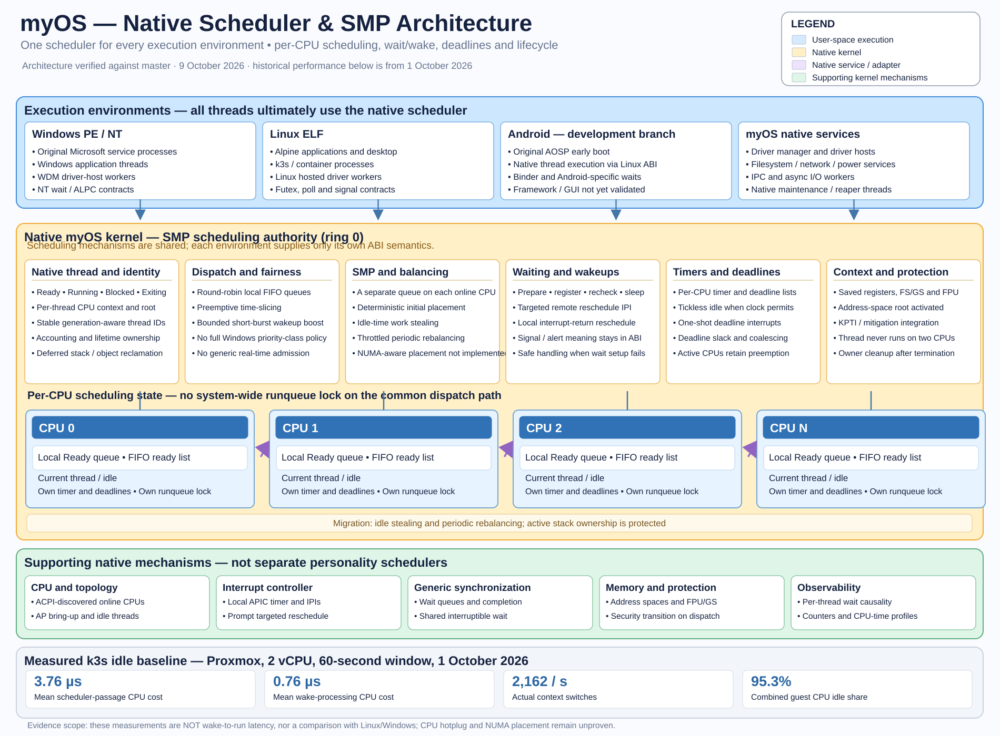

# myOS — One Kernel, Several Operating-System Worlds

**A technical story of the architecture, the engineering decisions and the functionality demonstrated so far.**

*Source review: myOS master, the Android development branch claude/android-x86-64-native-624c9f and the Windows-driver branch claude/windows-fltmgr-cpp-driver-071154; 9 October 2026. The accompanying illustrations are conceptual diagrams, not test reports. This publication contains no source code.*

## 1. The idea: an operating system beneath the interfaces

Many systems can run a Linux program. Fewer attempt to run original Linux and Windows system components on one independently developed kernel. myOS takes that latter route.

myOS is not a Linux distribution, a Windows replacement built from re-created user interfaces, or a hypervisor that runs several guest operating systems. It is a native x86-64 operating system in its own right. It manages the machine's processors, processes, memory, synchronization, files, networking and device access. Above that foundation it supplies the contracts expected by different operating-system environments.

The most important distinction is between **mechanisms** and **semantics**. A processor schedules a thread regardless of whether that thread belongs to a Windows or Linux application. Physical memory is physical memory regardless of whether an application calls it a section or a mapping. A network device cannot have independent, contradictory physical owners simply because two application environments use different configuration interfaces.

myOS therefore implements shared mechanisms once and translates different external contracts onto them. This makes operating-system compatibility a question of faithfully implementing interfaces, while retaining one native authority for the underlying machine.

**Reading the complete architecture diagram.** The blue boxes are the environments that applications interact with. The large orange area is the native kernel's generic machinery and environment-specific entry points; the lower layers represent native resource services, device access and hardware. The strongest claim of the drawing is architectural: Linux, Windows and Android do not each own a separate physical machine. Their execution environments converge on shared mechanisms.

The image also includes examples that are not all validated today. In particular, it should **not** be read as evidence of complete Windows NTFS support, a working Android graphical desktop, a complete USB driver stack or universal Windows-driver compatibility. Some responsibilities shown under the kernel are in fact implemented through ring-3 native services. The chapter-level explanations below give the precise ownership boundaries.

## 2. What belongs to the kernel, and what does not

The native kernel is the source of truth for process and thread identities, address spaces, memory objects, interrupts, device claims and access rights. It contains a native scheduler, multicore coordination and synchronization mechanisms. It handles virtual memory and maps memory objects between authorized address spaces.

These resources outlive the names that any single operating-system interface gives them. A Linux file descriptor and a Windows handle are different contractual objects, but both ultimately require a valid underlying resource, access rights and correct lifetime management. A Windows process may have NT-specific process and thread semantics; that does not require a second CPU scheduler.

The same distinction governs system services. Hardware-independent coordination such as choosing which driver to start belongs in a native user-space manager, not a new Windows- or Linux-specific hardware owner. Power policy is handled by a native service; the kernel provides the guarded hardware operations. A filesystem provider can run outside the kernel and still present filesystem-neutral operations to the VFS.

**The critical design rule is: one generic mechanism where the problem is generic, one compatibility adapter where the contract is specific.** Implementing a Windows ALPC transport, an Android Binder device or a Linux socket interface does not justify creating three independent process schedulers or three unrelated hardware-access systems.

This creates a demanding engineering problem. The common mechanism must be strong enough to support the semantics required by each environment, including cancellation, error behavior, rights transfer, deadlines and object lifetimes. Merely sharing the happy-path data transfer is insufficient.

### One shared scheduler beneath every environment

This common execution model has its own detailed engineering story: [**One Scheduler, Multiple Operating-System Environments**](11-one-scheduler-multiple-environments.md). Every Linux thread, original Windows service thread, native driver-host worker and Android-development-branch thread ultimately uses the same native SMP scheduling machinery. The implementation has per-CPU ready queues, timed preemption, bounded wakeup preference, idle-time work stealing, periodic balancing, a shared wait/wake mechanism, tickless idle and explicit thread-lifecycle safeguards. The dated Proxmox/k3s baseline provides measured CPU costs while keeping those distinct from wake-to-run latency. The article also identifies features not presently proven, including general CPU hotplug, NUMA-aware initial placement and complete Windows priority-class semantics.

## 3. Linux is a real workload, not just an executable-loader demonstration

The Linux environment uses native myOS processes and memory while exposing the Linux contracts expected by ELF applications. The implementation includes extensive file, process, memory, socket, synchronization, namespace and system-information functionality. Linux-oriented views such as process information and system statistics can be constructed from native state rather than becoming the machine's only authoritative representation.

That distinction becomes apparent when running software that relies on many kernel facilities simultaneously. Alpine user space and the Wayland/Plasma desktop path have been used as real workloads. So has k3s: Kubernetes is not a single executable that happens to print something. It exercises threads, timers, file mappings, mounts, network interfaces, container-related facilities, process isolation and sustained filesystem activity.

A documented k3s performance run on an earlier master revision observed the unchanged Alpine k3s server announcing startup after about **12 seconds**, a Kubernetes node reaching **Ready after about 15 seconds**, and a first pod sandbox after about **33 seconds** in the recorded QEMU/KVM configuration. These numbers are specific historical measurements, not a promise of current performance on every hypervisor. Their significance is architectural: the workload drove a large cross-section of the operating system.

The optimization history is equally revealing. Performance problems were traced to over-broad wakeups, APIC access overhead, allocator contention, framebuffer-console work, network acknowledgements and filesystem journal behavior. In other words, once real programs were running, the work shifted from accepting API calls to eliminating actual system-level bottlenecks.

This is why the Linux milestone should be described as **real workload execution**, while leaving room for unsupported Linux ABI corners and remaining correctness work.

## 4. Windows is an execution environment with original Microsoft components

Running a Windows executable requires more than recognizing a PE image. Windows applications expect the loader, process environment, NT objects, registry, synchronization, file and network contracts, and communication with genuine Windows system services.

myOS uses Microsoft binaries from a user-provided Windows installation, not Microsoft code bundled into the myOS source. Original components such as ntdll, csrss, lsass, services and other Windows service processes execute against the myOS Windows personality.

This matters because the goal is not to imitate the responses of those services. Their actual implementations perform important work. The original Windows subsystem infrastructure participates in process creation, side-by-side activation, service control and RPC. When a dependency is missing, that missing contract is investigated and added to the appropriate layer.

The Windows startup work illustrates both progress and complexity. The repository documents authentic session and service components coming online, with RPC and service-control problems diagnosed through traces, breakpoints and observed NT behavior. The original Task Manager has progressed through substantial runtime and service initialization, but **a fully functioning Task Manager graphical session is not established by the reviewed evidence**.

The difference matters. Executing the original services is a major capability; passing every service dependency and reaching a usable Windows desktop is a separate and larger claim.

## 5. IPC: the point at which the architecture is tested hardest

The IPC overview is central to understanding myOS. Almost every sophisticated operating-system environment is a collection of processes communicating through operating-system objects.

Linux software expects pipes, local sockets, readiness mechanisms and event-oriented waits. Windows expects its NT object conventions and ALPC message and connection behavior. Android expects Binder transaction semantics and process identities. Native services need IPC of their own, independent of which application environment originated a request.

The generic layer supplies reusable building blocks: endpoints, byte streams and records, replies, shared memory objects, waits, readiness and completion machinery, and controlled rights transfer. The environment-specific layer supplies the meaning: Linux file-descriptor behavior, NT port objects and message attributes, or Binder object references and transaction rules.

The source confirms an important boundary that the simplified image can hide: **the kernel does not contain one giant protocol that is simultaneously ALPC, Unix sockets and Binder**. It contains native mechanisms on which their distinct semantics are adapted. The generic infrastructure has grown through audits that specifically targeted duplicated queues, readiness paths and completion handling.

There are still limits. Some wait and completion semantics remain specific to their environment, and some changes proposed in the IPC architecture records require further validation. It would be misleading to treat every feature drawn in the IPC infographic as independently acceptance-tested.

### Windows ALPC: an example of authentic semantics built on shared mechanisms

The ALPC diagram zooms in on one concrete consequence of this philosophy. Original Microsoft processes communicate through ALPC ports. A service such as csrss or the RPC service infrastructure does not merely expect a mailbox. It depends on connection ports, communication ports, object names, message IDs, request/reply correlation, security context, data-view attributes and correct wakeup behavior.

The Windows personality maintains the NT-specific port and connection contract. Beneath it, the native message-endpoint layer owns generic queueing and transport responsibilities. Shared memory objects provide the basis for section-backed data views. Native waiting and scheduling facilities provide blocking and wakeup behavior.

This separation has been exercised against original Microsoft software, not only synthetic test clients. The repository records issues involving stale ALPC message IDs, the identity of replies, RPC endpoints and service-control calls. Fixing the underlying semantics allowed original Windows system components to progress.

The lesson is subtle but important: compatibility is achieved not by returning an optimistic success code but by making the **actual original protocol participants work together**.

## 6. Devices: drivers do not need to live in ring 0

The driver diagram shows a second major architectural decision. Hardware driver logic runs in user-space processes. The kernel retains the operations that must be privileged: discovery, exclusive ownership, authorized memory-mapped I/O, interrupt delegation, DMA mappings and cleanup on process termination.

A native driver manager observes hardware, matches it against an immutable generated catalog and chooses a driver based on identity, priority and dependency rules. The manager does not need to understand Linux or Windows driver internals, and it does not itself claim a device. It starts the appropriate driver host, observes readiness and handles failure.

A native driver, an original Linux-source driver hosted through compatibility infrastructure and a WDM driver hosted through the Windows runtime therefore fit into one management model. What changes is the *driver-facing API*, not the ownership of the physical device.

Original Linux driver source has already been hosted in ring 3. Documented device paths include VirtIO input, storage and networking, with selected Hyper-V VMBus and keyboard operation. Other Hyper-V device drivers have been built and catalogued but have not all been driven against real hardware. The implementation deliberately distinguishes those cases.

DMA protection is especially significant here. A user-space driver may still command a physical device to read or write memory. The native kernel therefore mediates device claims and DMA mappings, and an available IOMMU enforces address translation for device requests. The design recognizes a vital hardware limitation: an IOMMU **isolation group**, not necessarily an individual device, can be the smallest enforceable protection domain.

Intel VT-d and AMD-Vi support have documented tests with emulated IOMMUs. Equivalent behavior on arbitrary physical hardware is not established solely by those tests.

**The larger result:** drivers from different software ecosystems can run above one native security and lifecycle framework rather than creating independent hardware-driver stacks inside separate guest operating systems.

## 7. Windows drivers: executable WDM images, not merely NT device names

The Windows driver infographic needs particularly careful reading. It correctly draws attention to Windows driver objects, the WDM programming model, the NT driver runtime and the device-hosting boundary. But several of its examples of Microsoft inbox drivers and green capability statuses go beyond the reviewed proof.

The actual achievement is still substantial.

The source includes a ring-3 Windows driver host, an NT kernel-driver ABI adapter, executable PE/COFF driver image loading and integration with the same native driver manager used by other driver families. A WDK-built test driver has been exercised through its real driver initialization routine. The branch documents handling of device objects, synchronous and deferred IRPs, cancellation, unload, reloading and survival of a host crash.

There is also a distinct Windows networking accomplishment: WDK-built **tcpip.sys and afd.sys implemented for myOS**, where their lower-level transport uses the existing native myOS networking stack. Repository acceptance work reports TCP loopback and UDP interactions through the Windows driver-host path, including listening, connecting, accepting, sending, receiving and cancellation. This does **not** establish a complete Windows NDIS stack or all original Winsock scenarios.

The source also contains a self-developed fltmgr.sys and a minifilter test artifact. Their existence is not evidence that the original Microsoft Filter Manager already runs. The own Filter Manager is explicitly classified as technical debt: the stated architectural direction is to run Microsoft's original fltmgr.sys in the existing host, connecting it to native mechanisms rather than building another independent filesystem kernel.

Here the line between a promising diagram and current reality is essential. **WDM image execution works in reported tests; universal compatibility with Windows inbox drivers, WDF, storage miniports, graphics drivers and the original Microsoft Filter Manager has not been demonstrated.**

Still, the distinction from simple application emulation is profound: myOS has implemented a path by which Windows *kernel-driver-format software* can execute inside an ordinary user-space process with access to native operating-system services.

## 8. Storage: a common file identity from application to block device

The storage drawing follows requests from Linux, Windows and Android-facing APIs through a common VFS, filesystem implementations, asynchronous queues and storage devices.

It expresses a real design goal: multiple operating-system interfaces should not require three unrelated representations of the same disk, filesystem or file object. The native VFS manages filesystem-neutral node and mount identity; personalities interpret their own paths, open flags, namespaces, handles and permissions. A mounted filesystem may be implemented directly or provided by a ring-3 filesystem host.

The source confirms a native ext4 implementation, memory-backed filesystem functionality, mount and overlay-related infrastructure, and filesystem-provider support. Original Linux ISO9660 and UDF filesystem implementations have documented read-only end-to-end use through the provider mechanism. The Android development branch separately introduces native read-only EROFS support suitable for its image requirements.

Under the filesystem sits a common block-device service. In the asynchronous path, a request is placed into a shared queue and the driver can work while other requests remain outstanding. Completions can arrive independently and are matched to the proper request. That removes the requirement for a synchronous user/kernel round trip for every hardware action, although class-specific behavior, device latency and bounded queues still affect real performance.

This design also makes driver provenance irrelevant to the VFS. A block device offered by a hosted Linux driver can be consumed through the same native storage class as another block device.

### A necessary correction about caching

The picture labels the cache as fully unified. The underlying implementation is more nuanced. File-backed memory objects, read-only shared executable pages and writeback caching exist, but the source's zero-copy audit notes that mapped file pages and the writable page cache can still hold separate frames. Complete, single-copy page-cache coherence across all paths should therefore **not** be claimed.

Likewise, references to NTFS, exFAT, every virtual disk format, snapshots and universal crash recovery are examples in an architecture illustration, **not an established inventory of implemented storage features**. The correct achievement is a reusable storage architecture with selected working filesystem and device paths.

## 9. Android: a third environment built on the same principles

The Android development branch adds original AOSP x86-64 user space, not another booted Linux kernel. It reuses the native execution and Linux-facing mechanisms already available, with Android-specific requirements such as first-stage initialization, image-mounted filesystems, SELinux policy, Binder, process groups, network controls and a graphical composition interface.

This is another good demonstration of the generic-versus-specific design rule. Binder's transaction and object semantics belong to the Android-facing interface, while the kernel's generic endpoints, waiting, memory objects and process authority provide reusable foundations. Android's filesystem and boot requirements should strengthen the shared storage and environment primitives rather than creating a separate Android-only machine.

The 9 October branch audit documents genuine progress: original AOSP initialization reaches **SELinux enforcing** with original policy and a set of authentic services, including init, ueventd, apexd, logd, servicemanager, vold and selected security-related components. The audited boot is then stopped by bpfloader. Zygote, system_server, SurfaceFlinger, adb and an interactive app were **not demonstrated** in that run. The same audit reports missing complete regression evidence and outstanding isolation issues on the branch.

The Android image can therefore be understood as a compelling illustration of the intended third execution environment, but not a screenshot of a completed Android desktop. Its real achievement so far is progressing authentic AOSP boot atop the native kernel.

## 10. What has been demonstrated, and what remains unproven

The status infographic is most useful as a map of areas that already have implementation work behind them. Its colored circles should not, however, be treated as a formal test matrix. The accurate evidence status is narrower.

| Area | Evidence from the reviewed repositories | Limit of the claim |
|---|---|---|
| Native kernel | Actual process, memory, IPC, VFS, device and synchronization mechanisms; extensive tests and real workloads | Not a formal verification or security certification |
| Linux execution | Alpine, Plasma/Wayland and documented k3s workload runs | Not every Linux API or configuration |
| Native and hosted Linux drivers | VirtIO paths and selected Hyper-V support exercised | Not every catalogued driver or hardware platform |
| DMA isolation | Intel VT-d and AMD-Vi implementations tested with emulated hardware | General physical-platform validation remains separate |
| Windows applications and services | PE loading and original Microsoft system processes; substantial ALPC/RPC/service startup | Not a complete interactive Windows desktop or universal app support |
| Windows WDM driver hosting | Executable WDK-built driver, IRP lifecycle and host-failure scenarios in repository acceptance reports | Not universal WDM/KMDF/WDDM compatibility |
| Windows AFD/TCPIP | Own native-backed Windows .sys drivers tested through the driver host | Not the complete original Microsoft network driver stack |
| Original Microsoft fltmgr.sys | Required dependencies and integration being analyzed | **Not shown running successfully** |
| Storage | Native VFS/ext4, asynchronous device paths and ring-3 ISO9660/UDF providers | Not a unified cache for every mapping or all file formats shown |
| Android | Authentic AOSP boot through enforcing SELinux and several services in development branch | No complete framework, adb or interactive graphical app acceptance |

The source documents distinguish green test runs at particular revisions from unexecuted acceptance scripts, later changes and separate development branches. That distinction needs to survive in any public description. A successful QEMU test of one driver is not equivalent to a general hardware compatibility certification; a graphic showing a familiar Windows component is not proof that all its dependencies now work.

The extra implementation-status infographic in the repository is an earlier conceptual illustration. Some of its stronger claims, including original Microsoft Filter Manager execution and a broadly complete Windows driver ecosystem, are **not supported by the verified material** and are not repeated as facts here.

## 11. What makes this work different

Taken individually, the technical pieces resemble familiar operating-system research topics: a scheduler, a virtual memory manager, a network stack, a compatibility ABI, a driver host.

The notable engineering achievement is their **composition**.

A Linux application can use Linux-facing calls on native processes. An original Windows service can communicate using its expected NT and ALPC protocols while depending on the same kernel's memory and scheduling. A Windows-format driver can execute in a user-mode host, while Linux-source drivers use a separate compatibility host, both under shared device-management rules. Storage and network services serve multiple consumers without making one compatibility environment the real owner of the hardware. An emerging Android environment attempts to reuse these same facilities instead of booting another kernel.

This design imposes discipline: when a new Windows routine is missing, the first question is whether the underlying generic capability already exists. When an Android service demands a new synchronization or filesystem behavior, the question is whether that requirement belongs in the native mechanism or solely in the Android ABI. When a driver fails, the resource owner is known and cleanup is enforced at the shared native boundary.

That discipline is also why the work cannot be evaluated by simply counting supported system calls or compiled drivers. The most meaningful proof is that **original software exercises the shared mechanisms under realistic conditions**, and that previously working environments remain correct as new ones are added.

## Closing perspective

myOS is not yet a finished, universally compatible alternative to Linux or Windows. Nor is it merely a set of architectural diagrams waiting for an implementation.

It is a running, independently developed operating-system kernel with demonstrated Linux workloads, substantial original Windows user-space execution, real user-mode driver infrastructure—including WDM driver-host tests—and a third Android environment that has reached meaningful authentic boot milestones.

The common thread is simple: **different operating-system interfaces, one native operating system underneath**.

That is what the diagrams describe. The source review shows how much of that idea has already become executable machinery—and where the remaining boundaries of proof still are.

---

*Review method:* The architecture and claims above were cross-checked against the native kernel and service responsibilities, VFS and filesystem-provider documentation, asynchronous I/O and IOMMU design, original Linux-driver-host records, Windows ALPC and original-service startup analysis, the Windows WDM-host and network-driver acceptance records, and the Android development branch audit. Source was inspected; no fresh all-subsystem boot or hardware acceptance suite was executed specifically for this publication. The narrative deliberately avoids source listings and does not redistribute external operating-system components.
