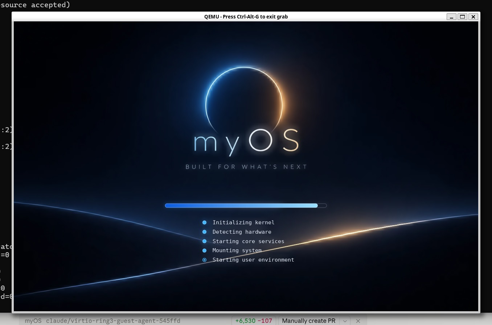
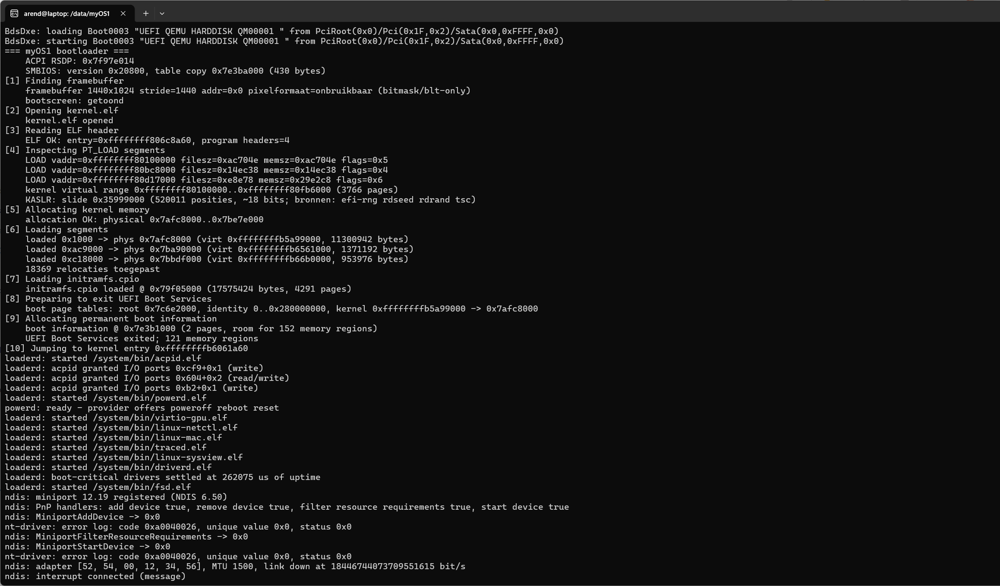
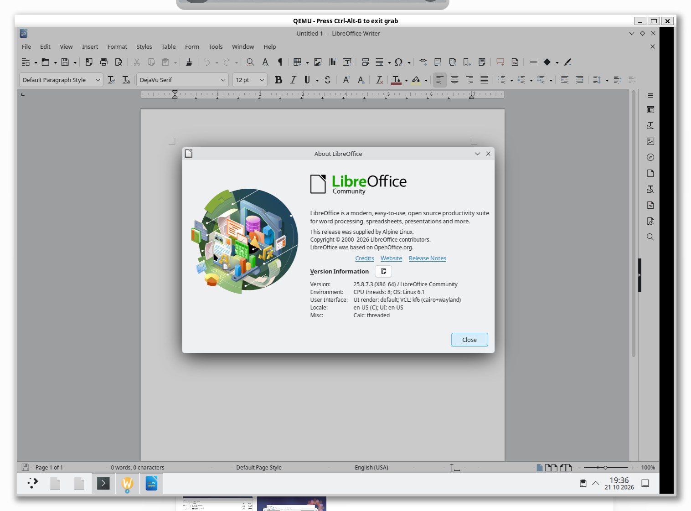
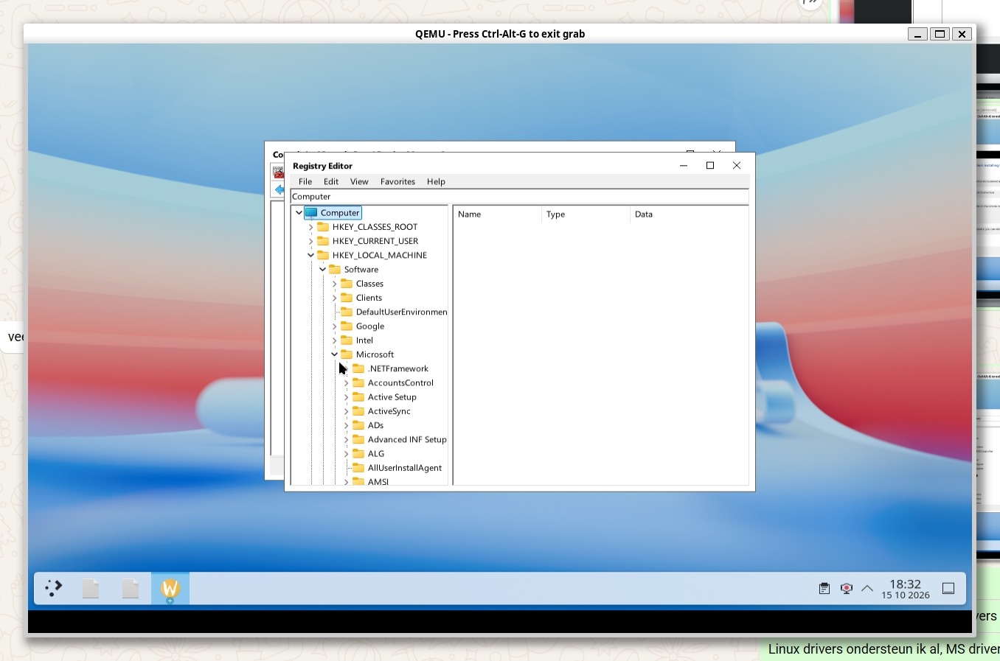
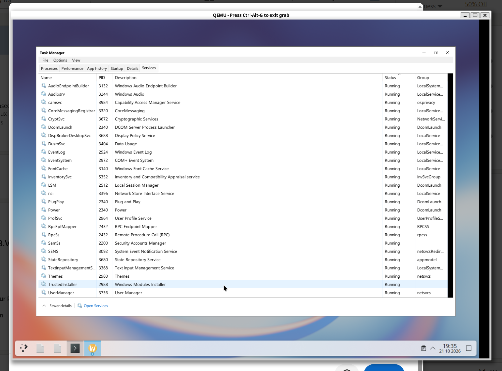
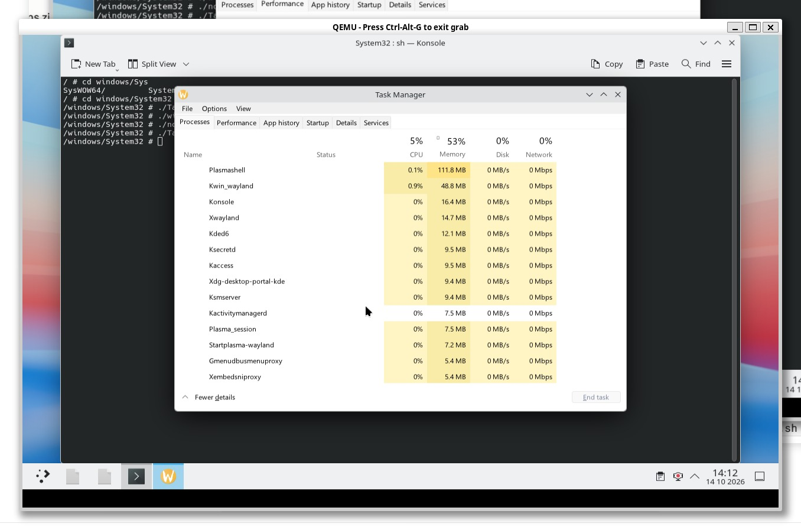
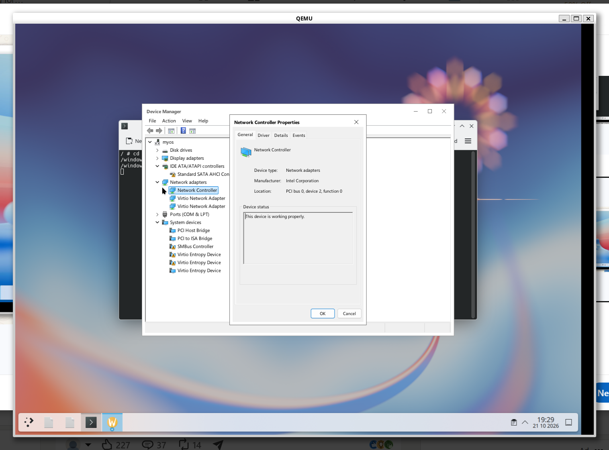
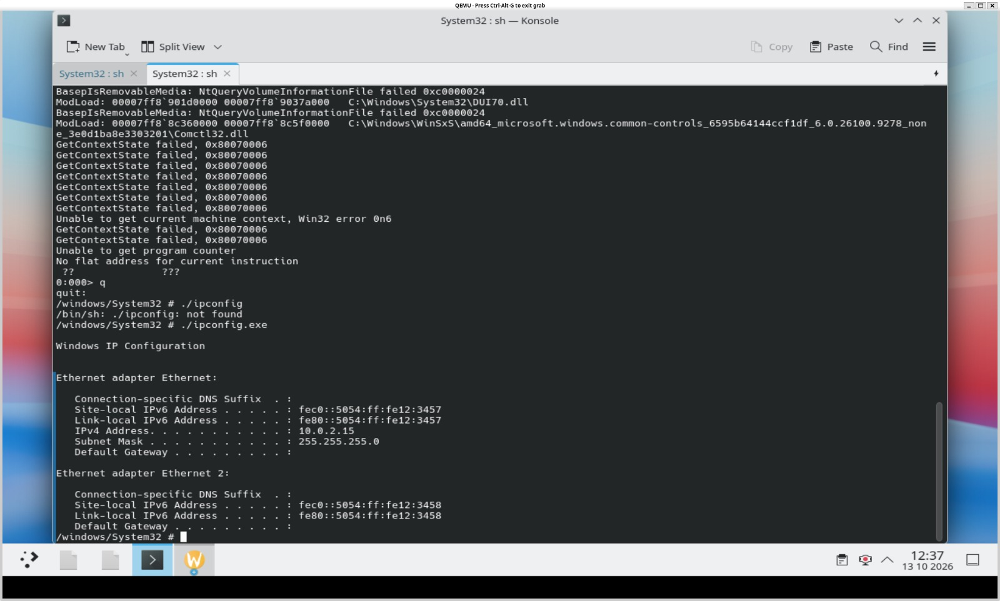

# myOS — Screenshots

Visual snapshots of myOS during development. These images illustrate specific observed screens and do not imply complete application, driver or platform compatibility.

## Boot and system architecture

### Bootscreen

### boot

### myOS Current System Architecture

### myOS Complete System Architecture Diagram (1)

.png)

## Linux and Windows applications

### Notepad and kwrite

### libreoffice

### regedit

## Windows services and management

### services

### taskmanager

### taskmanager details

### task manager performance

### device manager

### windows mmc certificates

## Networking

### networkdrivers

### ipconfig

## Android

### Android boot

### Android FOSS

### Android Clock

---

[Back to the project overview](../README.md)
